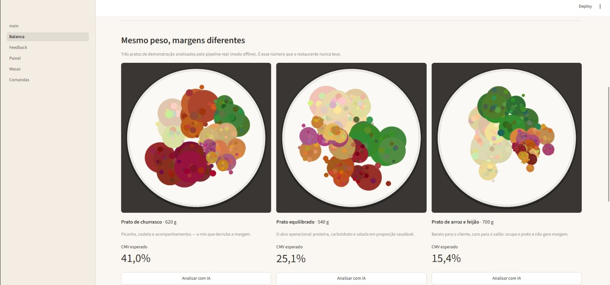
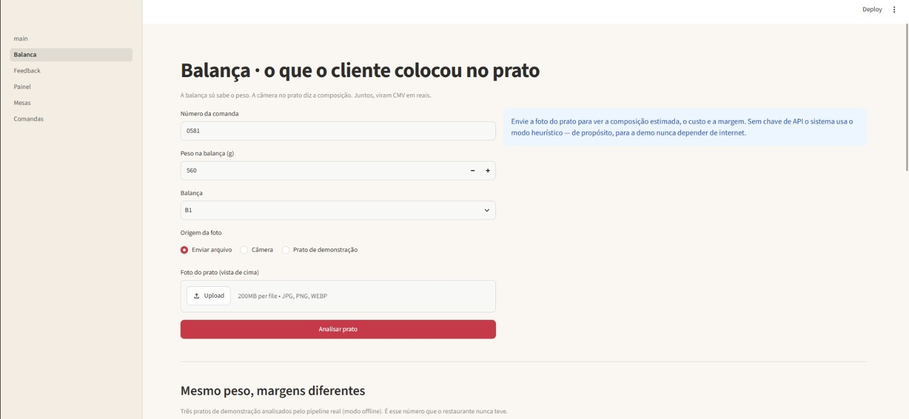
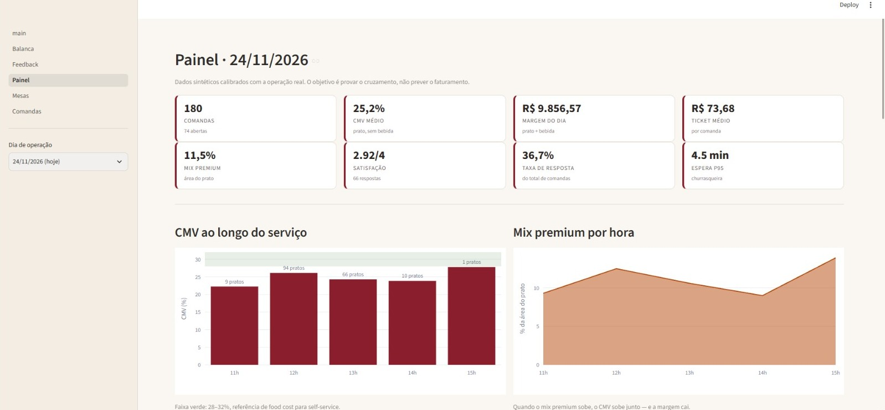
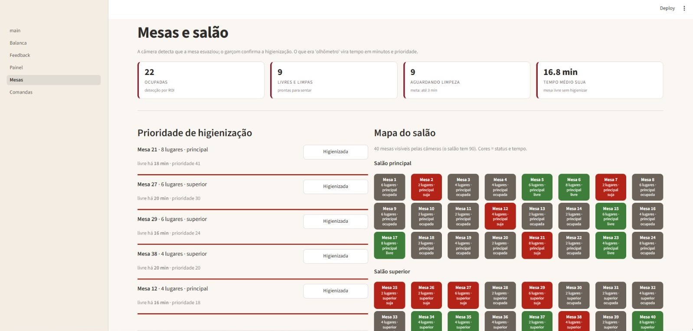
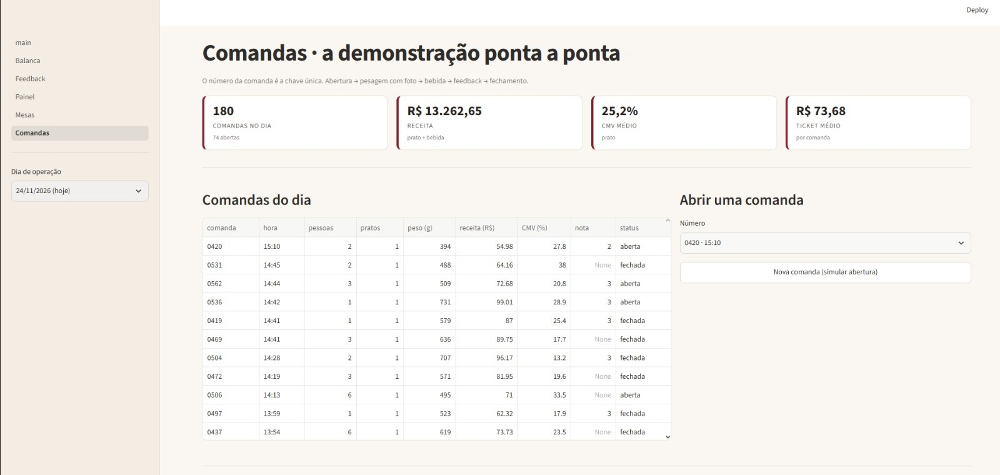
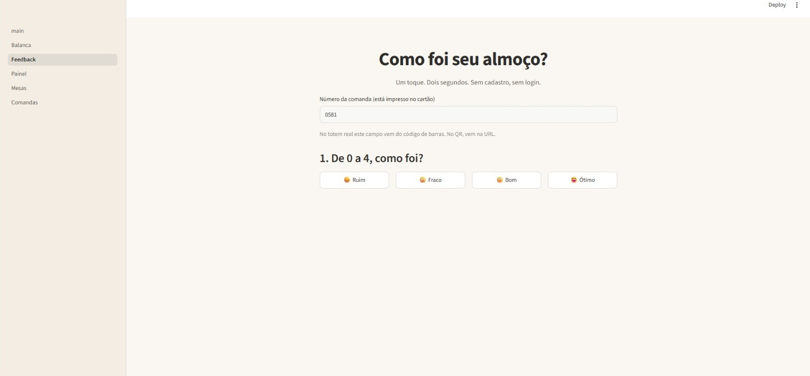
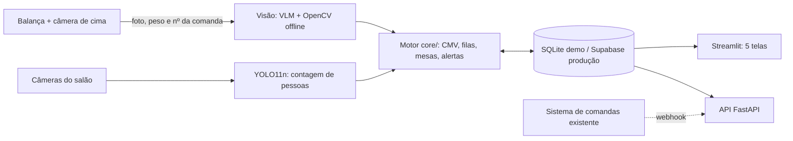

# Bovinu's · Inteligência Operacional

> Camada **não invasiva** sobre o sistema de comandas do **Bovinu's Grill & Beer** (Rua Augusta, SP).
> Hackathon FMU 2026.

| ▶ Vídeo (2 min) | 📊 Slides (5) | 📄 Detalhamento | 🧩 Diagramas |
|---|---|---|---|
| [Assistir](docs/video/bovinus-2-minutos.mp4) · [arquivo](docs/video/bovinus-2-minutos.mp4) | [PDF](docs/apresentacao/Bovinus-Inteligencia-Operacional-5-slides.pdf.pdf) | [Técnico](docs/DETALHAMENTO.md) · [Plano](docs/PLANO-TECNICO.md) | [Mermaid](docs/DIAGRAMAS.md) |

**Equipe:** Alexsandro Costa - RA 2026103099
            Joana Lima - RA 2025108046
            Thiago Dantas - RA 2025102930

---

## Resumo

A balança do restaurante sabe **quanto** o cliente colocou no prato, mas não **o quê**. Em um self-service
de R$ 119/kg com 600 clientes por dia e pico de 70 minutos, isso esconde a margem real.
Nossa solução anexa uma camada de percepção ao ponto onde o dado nasce (a balança) e usa o **número da
comanda como chave única**, sem alterar o caixa, a recepção ou o sistema de comandas.

## O problema

| Dor | Hoje | Passa a existir |
|---|---|---|
| **Mix do prato e CMV** | só o peso | composição por categoria, custo/kg, CMV e margem por comanda |
| **Filas** | "olhômetro" do gerente | espera estimada por estação e fila na escada |
| **Limpeza de mesa** | cobrança verbal | cronômetro por mesa e ranking de prioridade |
| **Qualidade e desperdício** | boca a boca | nota por item, resto e reposições de cuba por dia |

## A solução

Cinco telas, cada uma para quem opera, sobre um mesmo núcleo (`core/`):

| Tela | Para quem | O que faz |
|---|---|---|
| **Balança** | operador | foto do prato → composição → CMV, com correção em 2 segundos |
| **Feedback** | cliente | 4 carinhas, Pergunta do Dia e "sobrou?", por QR ou totem |
| **Painel** | gerente | CMV por hora, mix × satisfação, fila, cubas, alertas e simulador de cenário |
| **Mesas** | garçom e metre | mapa do salão, cronômetro e prioridade de higienização |
| **Comandas** | demonstração | da comanda ao prato, à margem e à avaliação |

Como o prato vira número: a foto dá a **área** de cada categoria, a balança dá o **peso total**, e o sistema
converte área em peso por densidade e multiplica pelo custo/kg. Exemplo do sistema: 550 g, CMV de **29,8%**
e margem de **R$ 45,95**. Abaixo de 0,55 de confiança, o prato vai para revisão humana.
A conta completa está no [detalhamento](docs/DETALHAMENTO.md#como-o-cmv-é-calculado).

## Capturas de tela

<table>
<tr>
<td width="50%"><br><sub>><b>Balança:</b> foto e peso viram composição</sub></td>            
<td width="50%"><br><sub><b>Balança:</b>  CMV e margem.</sub></td>
<tr></tr>            
<td width="50%"><br><sub><b>Painel:</b> CMV, mix × satisfação, fila e alertas.</sub></td>
<td width="50%"><br><sub><b>Mesas:</b> cronômetro e prioridade de higienização.</sub></td>
<tr>
<td width="50%"><br><sub><b>Comandas:</b> do número da comanda à margem e à avaliação.</sub></td>
<td width="50%"><br><sub><b>Feedback:</b> 4 carinhas e Pergunta do Dia, por QR ou totem.</sub></td>
</tr>
</table>

## Vídeo

[▶ Assistir ao vídeo de 2 minutos](docs/video/bovinus-2-minutos.mp4) · também em [`docs/video/`](docs/video/bovinus-2-minutos.mp4).

## Apresentação

[Slides em PDF (5)](docs/apresentacao/Bovinus-Inteligencia-Operacional-5-slides.pdf.pdf): problema e proposta,
passos de desenvolvimento, estrutura da solução, integração entre as frentes e resultado final.

## Como rodar (2 comandos)

```powershell
pip install -r requirements.txt
streamlit run app/main.py
```

No Windows, `.\run.ps1` cria o ambiente virtual, valida tudo e abre o painel em `http://localhost:8501`.
**Não precisa de chave de API:** sem chave, a análise do prato usa um pipeline heurístico offline (OpenCV)
sobre pratos de demonstração. Com `GEMINI_API_KEY` no `.env`, o mesmo código usa um VLM.

```powershell
uvicorn api.main:app --reload --port 8000   # API opcional: http://localhost:8000/docs
pytest -q                                    # testes
python scripts/verificar.py                  # verificação do ambiente
python scripts/capturar_telas.py             # regenera os prints de docs/img/
```

## Arquitetura



Mais diagramas (fluxo da Balança e caminhos de integração) em [`docs/DIAGRAMAS.md`](docs/DIAGRAMAS.md).

**Integração sem mexer no que já funciona:** (A) conector de borda na balança, **implementado**;
(B) espelho/importação somente-leitura; (C) `POST /webhooks/comanda`, com endpoint simulador pronto.

## Estrutura do repositório

```
app/          Streamlit: 5 páginas + ui.py
core/         domínio sem dependência de UI (cmv, vision/, fluxo, alertas, servico, seed, demo)
api/          FastAPI (indicadores, pratos, feedback, comandas, webhook)
scripts/      verificar, gerar pratos, avaliar modelo, processar vídeo, capturar telas
tests/        CMV, fluxo, API e app
docs/         detalhamento, plano técnico, diagramas, vídeo, slides e prints
data/         banco local (gerado), ROIs de exemplo
```

O banco (SQLite) é gerado no primeiro acesso, com 3 dias de operação sintética (`core/seed.py`).

## Dados, privacidade e limites

- **Dados sintéticos**, calibrados com os números da operação. Nenhum dado pessoal de cliente é usado.
- **LGPD:** câmera da balança de cima, sem rosto; salão só com contagem agregada; feedback anônimo, ligado apenas à comanda.
- **Estimativa de gestão, não contabilidade:** os custos por kg são premissas de atacado, visíveis na interface.
- **Limites hoje:** integração real com o JS Softcom não feita, precisão do mix ainda a medir com 20 pratos, protótipo sem autenticação.
- **Impacto:** os números (~R$ 205/dia por 1 p.p. de mix premium, por exemplo) são **oportunidade estimada**, não retorno garantido.

## Requisitos da avaliação e onde encontrá-los

| Requisito | Onde |
|---|---|
| Detalhamento e desenvolvimento | [`docs/DETALHAMENTO.md`](docs/DETALHAMENTO.md), [`docs/PLANO-TECNICO.md`](docs/PLANO-TECNICO.md) |
| Problema e solução | seções acima |
| Capturas de tela (máx. 5) | [`docs/img/`](docs/img/) |
| Vídeo (máx. 2 min) | seção Vídeo |
| Slides (máx. 5) | [`docs/apresentacao/`](docs/apresentacao/) |
| Diagramas, código, banco e sistema | [`docs/DIAGRAMAS.md`](docs/DIAGRAMAS.md), `app/`, `core/`, `api/` |

Outros documentos: [Planta de câmeras](docs/CAMERAS.md) · [Integração](docs/INTEGRACAO.md)  · [Checklist de entrega](docs/CHECKLIST-ENTREGA.md).

