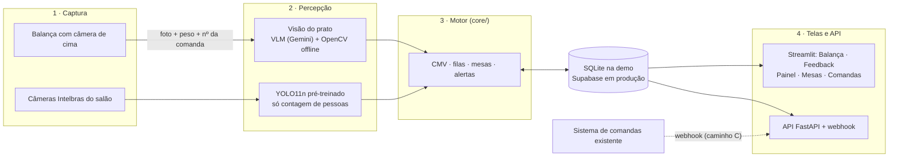
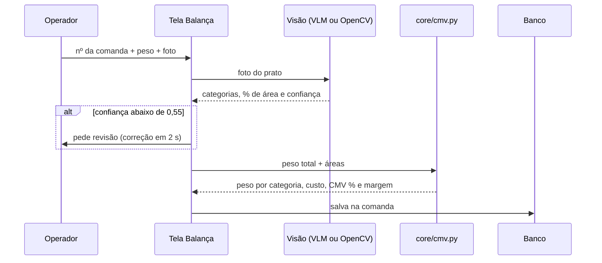
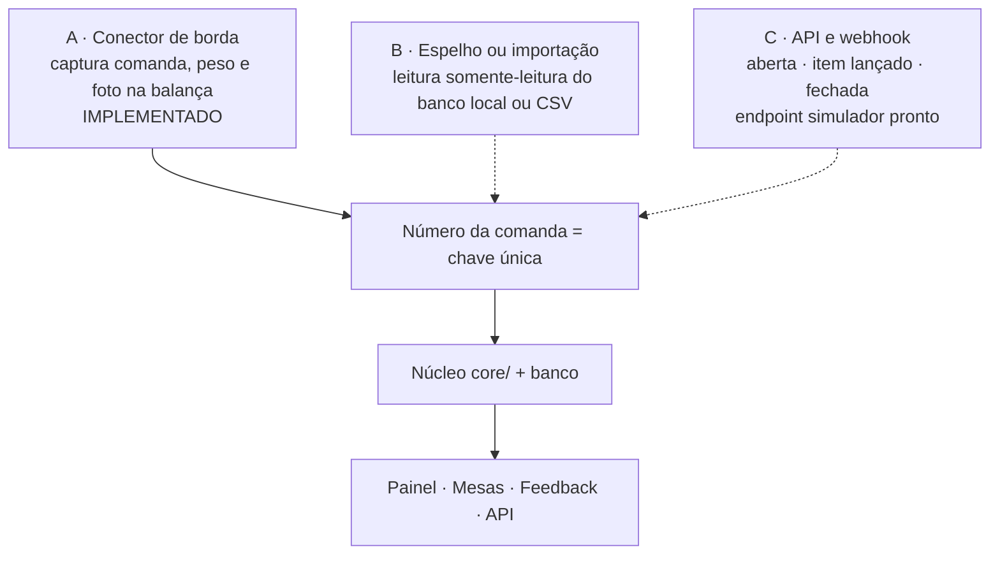

# Diagramas

Todos os diagramas abaixo são Mermaid e aparecem renderizados no GitHub.

## 1. Arquitetura em camadas

## 2. Do prato à margem (fluxo da Balança)

## 3. Integração sem mexer no que já funciona

A recepção humanizada e o caixa continuam exatamente como estão.
